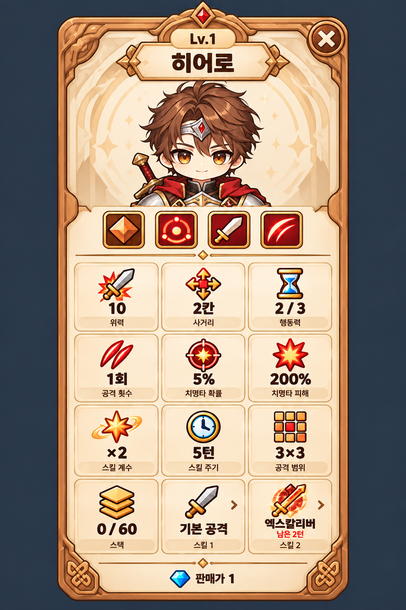

# 세로형 타워 정보 카드 시안 v3

사용자의 카드 형식 요청에 맞춰 가로형 v2를 세로형 수집 카드로 재구성했습니다. 내장 imagegen으로 생성했습니다.

- 상단: 레벨·이름과 히어로 초상
- 중단: 키워드 아이콘 4개
- 하단: 정보 12칸을 3열 × 4행으로 배치, 판매가 표시

이번 요청에 따라 세로형 시안의 열·행 구성을 제안한 것으로 기획서의 기존 6열 × 2행이나 실제 UI 코드는 수정하지 않았습니다. 수치는 배치 검토용 예시입니다.

생성 이미지에서 초상, 키워드 4개, 정보 12칸, 한글 문구와 판매가를 확인했습니다. Unity 연동 전의 검토용 이미지입니다.

프롬프트: [prompt.txt](prompt.txt)
