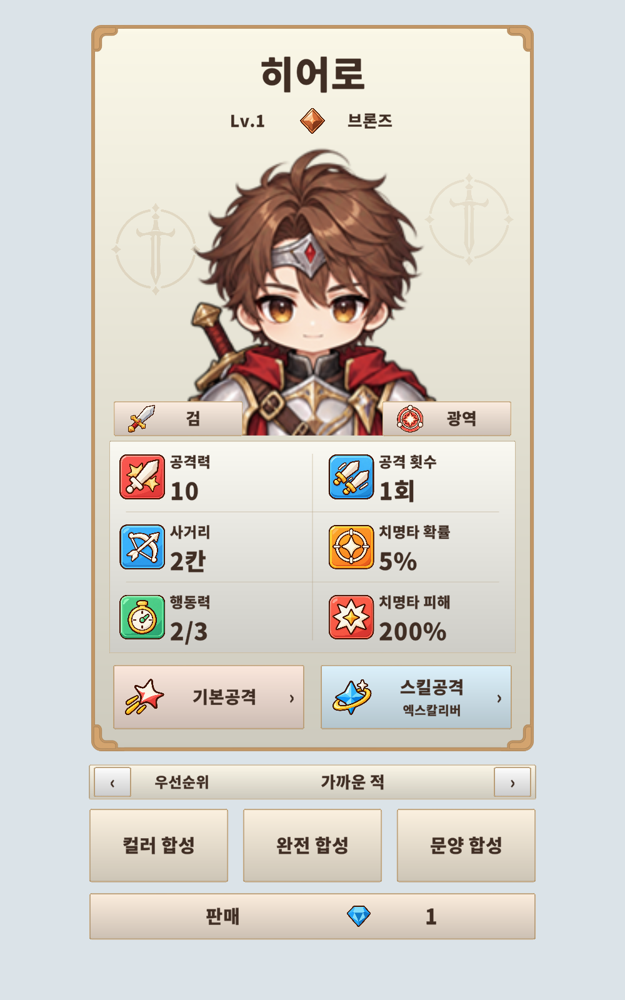

# 실제 타워 정보패널 카드 적용

시안 v7의 공용 프레임, 캐릭터 초상, 검 배경 문장, 등급/문양/공격 방식 배지와 색상 스탯 아이콘을 실제 정보패널에 적용했습니다.

## 적용 내용

- `Assets/2. Prefab/Canvas.prefab`의 기존 TowerInfoPanel 아래에 `UICommon/TowerInfoCard.prefab`을 중첩 프리팹으로 연결했습니다. 기존 Canvas/패널 ID와 타워·타일 전환 버튼은 보존했습니다.
- 이름, 레벨, 티어, 문양, 공격 방식, 초상 및 스탯은 선택된 타워의 실제 데이터와 최종 수치를 표시합니다. 앞면은 공격력/공격 횟수/사거리/치명타 확률/행동력/치명타 피해의 6칸입니다.
- 기본공격/스킬공격을 누르면 약 0.3초 동안 카드가 뒤집히고 해당 설명과 스킬 계수·지속/발동 조건·숙련도를 표시합니다. 돌아가기 버튼이 있습니다. 타워를 바꾸거나 패널을 닫으면 앞면으로 돌아갑니다. 일시정지 중에도 회전합니다.
- 기존 타겟 우선순위, 컬러/완전/문양 합성 및 판매를 카드 아래에 연결했습니다. 합성/판매와 타겟 변경은 플레이어 행동 가능 여부를 따릅니다.
- 브론즈는 제작한 배지를 사용합니다. 다른 티어의 기존 스프라이트가 없으면 등급 색상의 작은 보석을 UI 메시로 표시합니다. 시너지는 보라색 배지입니다.
- 검은 새 배경 전용 문장을 쓰고, 다른 문양은 기존 타워 문양을 옅게 표시합니다. 시너지의 초상/문양도 실제 외형 ID를 따릅니다.
- 지원 타워의 사용하지 않는 스탯은 `-`로 유지합니다. 시너지 선택 시 이전 타워의 공격 설명이 남지 않게 처리했습니다.
- 한글은 프로젝트의 `NotoSansKR-Black SDF`를 명시적으로 연결했습니다. 이 폰트에 없는 곱셈 기호 대신 카드에서는 `x2`, `3x3` 형식으로 표시합니다. 밝은 카드 안의 글자는 `CTxt_` 이름으로 자동 스테이지 대비 처리에서 제외했습니다.

기존 스킬 기능이나 전투 계산은 추가하지 않았습니다. 상세 면은 기존 TowerInfoPanel의 설명 계산을 연결했으며, 지원 타워의 미구현 스킬은 그대로 미구현으로 표시합니다. 검 광역의 상세 제목은 기획의 엑스칼리버입니다. 다른 스킬의 이름은 공용 스킬공격 표시를 사용합니다.

## 파일

- [카드 프리팹](../../Assets/2.%20Prefab/UICommon/TowerInfoCard.prefab)
- [TowerInfoCardView](../../Assets/3.%20Scripts/05.%20UI/TowerInfoCardView.cs): UI 바인딩, 초상/배지/배경, 상세 면 회전.
- [TowerInfoPanel](../../Assets/3.%20Scripts/05.%20UI/TowerInfoPanel.cs): 기존 게임 데이터와 조작 이벤트 연결.
- [TowerTierBadgeGraphic](../../Assets/3.%20Scripts/05.%20UI/TowerTierBadgeGraphic.cs): 티어 스프라이트가 없을 때 쓰는 작은 보석 메시.
- `TowerVisual.CharacterSprite`: 현재 캐릭터 초상을 정보 카드에 제공하는 읽기 전용 속성.

기존 레이아웃 9개 그룹은 비활성 상태로 보존했고, 변경 직전 Canvas는 `before/`에 보관했습니다. 프리팹을 고치면 Canvas의 중첩 카드에도 반영됩니다.

## 확인

- 런타임/Editor 전체 C# 컴파일: 경고 0, 오류 0.
- 격리된 Unity 6000.3.9f1 Play Mode에서 카드 참조/한글 폰트/일시정지 중 버튼 회전/중간에 닫고 다시 열기/중첩 프리팹 참조 127개 검사 통과.
- 실제 TowerInfoPanel 소스와 게임 의존성 테스트 대역으로 선택 전환, 수치, 지원/시너지 표시, 모든 티어 배지, 타겟 변경, 플레이어/적 턴에 따른 버튼 활성화, 합성·판매 호출 23개 검사 통과.
- Canvas 변경 범위와 씬의 기존 오버라이드, 프리팹 배포 바이트 일치 136개 검사 통과.
- 실제 배포 Canvas 프리팹을 Unity에서 다시 읽어 중첩 카드/컨트롤러 참조와 비활성 구 레이아웃을 확인했습니다.

검증은 열린 본 게임 프로젝트와 분리된 프로젝트에서 수행했습니다. 전체 전투 씬을 실행한 검증은 아닙니다. 격리 프로젝트의 Play Mode 시작 때 Unity Search 인덱스의 Editor 예외가 기록되었으나, UI 검사나 제품 코드의 예외는 없었습니다. 게임 의존성 테스트 대역은 `outputs/`와 검증 프로젝트에만 있고 본 게임 Assets에는 들어가지 않았습니다.

기록: `build-verification.json`, `play-verification.json`, `panel-binding-verification.json`, `export-verification.json`, `canvas-import-verification.json`. 재현용 빌더는 `BuildCard.cs`, 적용 스크립트는 `Integrate.cjs`입니다. 적용 스크립트는 이후 Canvas 변경을 감지하면 덮어쓰지 않습니다.

[기본공격 뒷면](card-basic-detail.png) · [스킬공격 뒷면](card-skill-detail.png)
