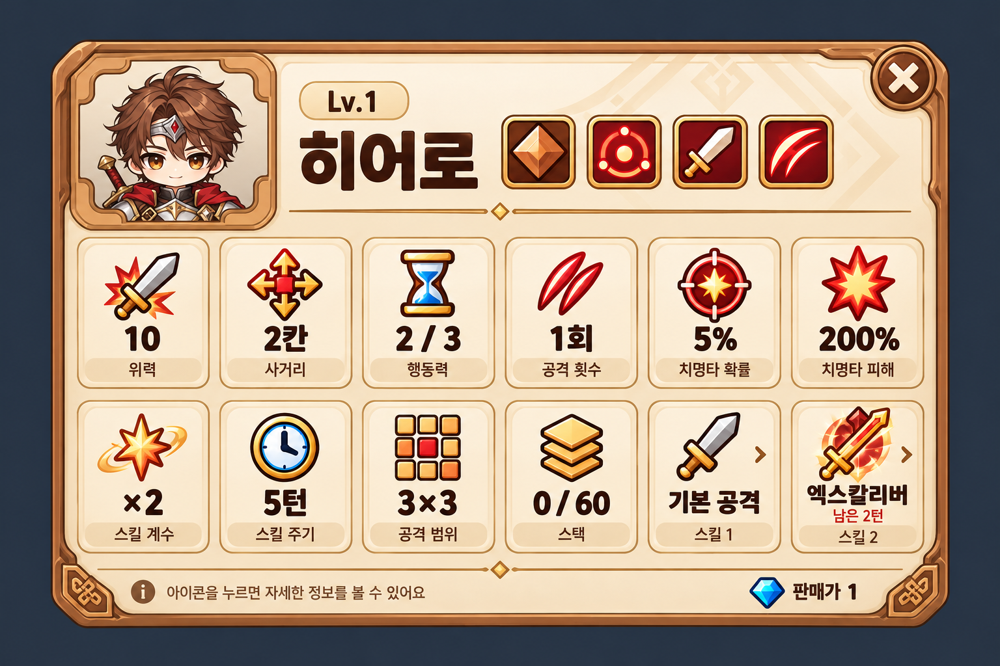

# 타워 정보패널 시안 v2

2026-10-17. 내장 imagegen으로 생성한 가로형 정보 카드 시안. Unity UI에 연결하기 전의 검토용 이미지입니다.

- 현재 히어로 타워 초상과 아이보리·브론즈 프레임을 참고했습니다.
- `Assets/20. 통합 기획서.txt`의 [타워 정보 카드]에 맞춰 머리줄, 키워드 아이콘 넷, 2줄 × 6칸, 판매 가격으로 구성했습니다.
- 12칸은 위력, 사거리, 행동력, 공격 횟수, 치명타 확률, 치명타 피해, 스킬 계수, 스킬 주기, 공격 범위, 스택, 스킬 1, 스킬 2 순입니다.
- 합성·판매 조작은 넣지 않았습니다. 판매가는 정보로만 표시합니다.
- 숫자는 레이아웃 검토용 예시이며 현재 CSV나 최종 밸런스를 뜻하지 않습니다.
- 실제 타워 에셋, 프리팹, 스크립트와 기존 시안은 수정하지 않았습니다.

생성 프롬프트: [prompt.txt](prompt.txt)

참고 이미지:

- `outputs/character-art-audit-v1/unity-rendered-towers/Tower_1101.png` — 현재 히어로 초상·타일
- `Assets/4. Asset/5. UI/Concepts/TowerInfoPanel_Card_Concept_v1.png` — 기존 UI 재질·색감

검토: 12칸이 정확히 두 줄로 배치되었고, 초상·이름·키워드 아이콘·판매가가 잘리지 않는 것을 생성 이미지에서 확인했습니다. 게임 해상도에서의 가독성 및 입력 동작은 실제 UI 구현 시 별도로 확인해야 합니다.
