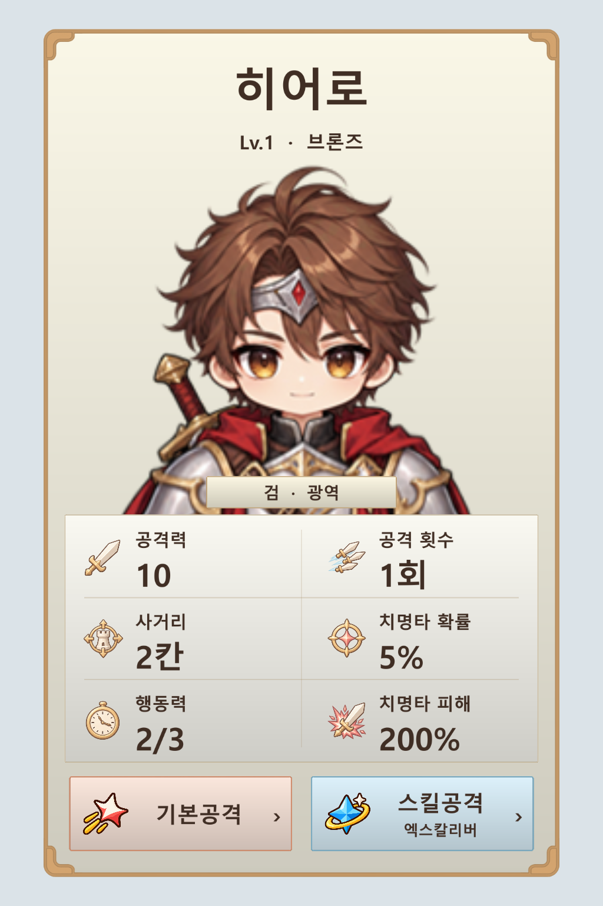

# 공용 UI로 만든 스탯 균형형 카드 시안

선택한 B안의 이름 → 초상화 → 기본 스탯 6개 → 공격 상세 버튼 순서를 유지했습니다. 카드와 버튼은 프로젝트의 실제 `Shared_UI_Atlas.png`와 `UITilePanel`을 사용하며, 기존 히어로 초상과 스탯 아이콘을 배치한 Unity uGUI 렌더 시안입니다.

- 바깥 카드: 공용 장식 프레임 `Shared_Frame_Decorated`.
- 키워드, 스탯 영역, 버튼: 공용 간결 프레임 `Shared_Frame_Compact`.
- 바탕: 공용 `Shared_A_Surface`. 배경과 테두리 색만 지정하므로 타워·적 정보 카드에 같은 구조를 사용할 수 있습니다.
- 스탯: 공격력, 공격 횟수, 사거리, 치명타 확률, 행동력, 치명타 피해의 2열 × 3행.
- 하단: 공용 기본공격/스킬공격 아이콘. 스킬 이름은 보조 문구로 표시합니다. 버튼을 누르면 상세 면으로 회전시키는 흐름을 제안합니다.

수치는 배치 검토용입니다. 현재 게임의 정보 패널 프리팹이나 동작은 변경하지 않았습니다. 이 시안에 회전 동작이 구현되어 있지는 않습니다. 렌더용 한글 폰트는 격리된 검증 프로젝트에서만 사용했으며 본 게임 Assets에는 추가하지 않았습니다.

## 새 공용 아이콘

| 용도 | 그림 | 실제 게임 에셋 |
| --- | --- | --- |
| 기본공격 | 코랄빛 타격 문양 | [Icon_Attack_Basic_Common.png](../../Assets/4.%20Asset/5.%20UI/Icon_Attack_Basic_Common.png) |
| 스킬공격 | 파란 마력 문양과 금색 궤도 | [Icon_Attack_Skill_Common.png](../../Assets/4.%20Asset/5.%20UI/Icon_Attack_Skill_Common.png) |

두 아이콘은 내장 imagegen으로 각각 생성했습니다. 무기 종류에 종속되지 않는 공용 분류 아이콘입니다. 실제 투명 배경, 512 × 512, 동일한 최대 외곽 크기 448px, 중앙 피벗, 100 PPU, Bilinear 필터, 압축 없음으로 저장했습니다. 새 단일 Sprite 에셋이므로 기존 아틀라스 GUID/스프라이트 ID에 영향을 주지 않습니다.

생성 프롬프트: [기본공격](basic-attack-prompt.txt), [스킬공격](skill-attack-prompt.txt). 생성 원본은 `basic-attack-generated.png`, `skill-attack-generated.png`입니다. `Prepare.cjs`는 알파 경계에 맞춰 여백과 해상도를 통일하고 검증 프로젝트에 필요한 에셋을 복사합니다. `SharedCardPreview.cs`는 공용 UI 스프라이트와 기존 초상을 사용해 시안을 렌더링합니다.

검증: `verification.json`은 소스 해상도·투명 픽셀·최종 PNG 해시를, `unity-verification.json`은 실제 Unity 임포트와 공용 스킨 사용 확인 결과를 기록합니다.
