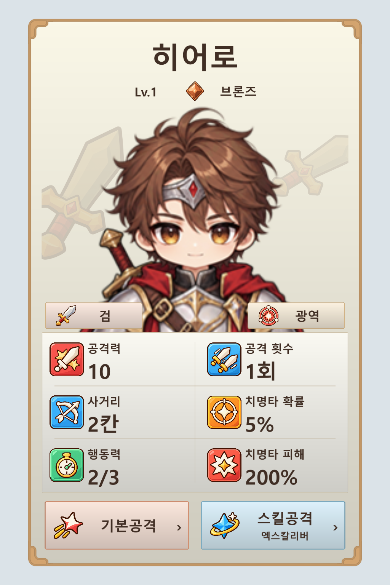

# 공용 UI 카드 + 색상 스탯/키워드 아이콘 시안 v6

오른쪽 공용 UI 카드의 간결한 구성을 유지하고, 왼쪽 시안처럼 색상 타일이 있는 스탯 아이콘 6개를 새로 만들었습니다. 검 문양, 광역 공격, 브론즈 티어 배지도 추가했습니다.

- 카드 바깥과 내부 버튼/패널은 기존 `Shared_UI_Atlas.png`, `UITilePanel`을 그대로 사용합니다.
- 스탯 6개는 공격력, 공격 횟수, 사거리, 행동력, 치명타 확률, 치명타 피해입니다. 행동력에는 시계 문양을 사용해 이동력과 구분합니다.
- 이름 아래에 브론즈 티어 아이콘을 작게 배치했습니다.
- 초상화 아래 양쪽에 검/광역 아이콘과 이름을 표시합니다.
- 캐릭터 뒤에는 같은 검 문양을 낮은 불투명도로 반복했습니다. 초상화 배경 영역 안에서만 보이게 마스크를 적용했습니다.
- 기존 기본공격/스킬공격 공용 아이콘과 기존 히어로 초상을 재사용했습니다.

이번 시안의 배경 문양은 검, 티어는 브론즈입니다. 다른 13문양이나 다른 4티어의 배지는 이번 작업에서 생성하지 않았습니다. 수치는 배치 검토용입니다. 실제 게임 정보 패널이나 카드 회전 동작은 변경하지 않았습니다.

## 저장된 에셋

[게임용 아틀라스](../../Assets/4.%20Asset/5.%20UI/Tower_Card_Icon_Atlas_v1.png): 1536 × 1536, 3열 × 3행, 각 셀 512 × 512. 실제 투명 배경, 아이콘 최대 외곽 448px, 중앙 피벗, 100 PPU, Bilinear, 압축 없음입니다. 기존 전역 스탯 아틀라스를 교체하지 않고 새 아틀라스로 저장했습니다.

| 종류 | 스프라이트 이름 | 개별 PNG | 생성 프롬프트 |
| --- | --- | --- | --- |
| 공격력 | CardStat_AttackPower | [PNG](CardStat_AttackPower.png) | [프롬프트](power-prompt.txt) |
| 공격 횟수 | CardStat_AttackCount | [PNG](CardStat_AttackCount.png) | [프롬프트](count-prompt.txt) |
| 사거리 | CardStat_Range | [PNG](CardStat_Range.png) | [프롬프트](range-prompt.txt) |
| 행동력 | CardStat_Action | [PNG](CardStat_Action.png) | [프롬프트](action-prompt.txt) |
| 치명타 확률 | CardStat_CriticalRate | [PNG](CardStat_CriticalRate.png) | [프롬프트](crit-rate-prompt.txt) |
| 치명타 피해 | CardStat_CriticalDamage | [PNG](CardStat_CriticalDamage.png) | [프롬프트](crit-damage-prompt.txt) |
| 검 문양 | CardBadge_EmblemSword | [PNG](CardBadge_EmblemSword.png) | [프롬프트](emblem-sword-prompt.txt) |
| 광역 공격 | CardBadge_AttackSplash | [PNG](CardBadge_AttackSplash.png) | [프롬프트](attack-splash-prompt.txt) |
| 브론즈 티어 | CardBadge_TierBronze | [PNG](CardBadge_TierBronze.png) | [프롬프트](tier-bronze-prompt.txt) |

아이콘 9개는 내장 imagegen으로 각각 생성했습니다. `*-generated.png`가 생성 원본입니다. `Prepare.cjs`가 투명 여백과 해상도를 맞춰 패킹합니다. 카드 시안은 `CardIconPreview.cs`에서 실제 Unity uGUI와 공용 스킨으로 렌더링합니다. 렌더용 한글 폰트는 격리된 검증 프로젝트에서만 사용했습니다.

`verification.json`은 원본 해상도, 투명 픽셀 수, 좌표, 스프라이트 ID 및 최종 PNG 해시를 기록합니다. `unity-verification.json`은 실제 Unity 임포트와 카드 렌더 확인 결과입니다.
