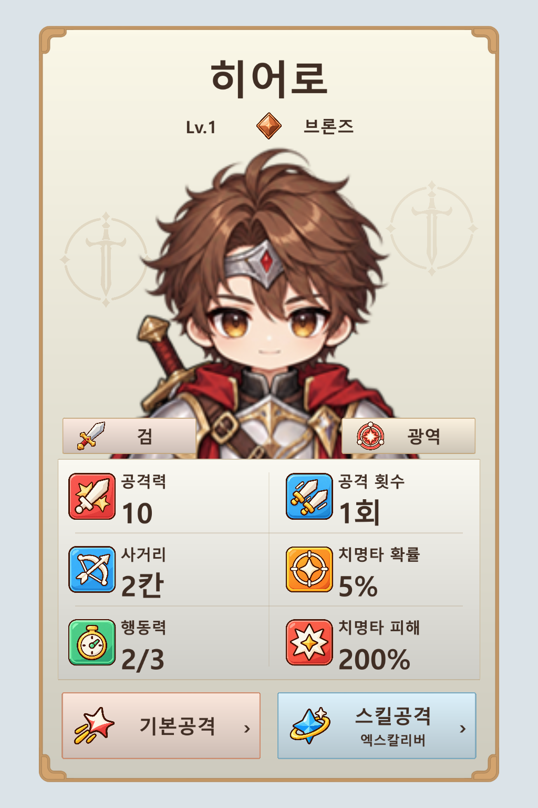

# 카드 배경용 검 문장 다시 제작

색상 배지용 검을 배경에 확대해서 사용하던 구성을 배경 전용 문장으로 바꿨습니다. 단색 검과 원형 문장을 캐릭터 양옆에 작게 배치하고 낮은 불투명도로 표시합니다. 중앙 배치를 확인했으나 검이 얼굴 뒤에 가려져 양옆으로 조정했습니다. 카드 프레임, 캐릭터, 스탯 및 키워드/공격 아이콘은 v6와 같습니다.

- [게임용 배경 문양](../../Assets/4.%20Asset/5.%20UI/Card_Background_SwordSigil_v1.png): 1024 × 1024 투명 PNG, 단일 Sprite, 중앙 피벗, 100 PPU, Bilinear, 압축 없음.
- 흰색 실루엣과 투명 알파로 저장하여 `Image.color`로 색과 불투명도를 조절합니다. 이번 시안은 따뜻한 갈색, 불투명도 16%와 12%입니다.
- 배경용 문양 두 개를 정방향으로 배치하고 초상화 배경 영역으로 마스킹했습니다. 원형 외곽이 카드 모서리에서 잘리지 않게 크기를 줄였습니다.
- [문양 확인 이미지](emblem-visibility-check.png)는 흰 문양이 보이도록 배경색을 넣은 확인용 이미지입니다. 게임용 PNG에는 이 배경색이 없습니다.

제작 방식은 내장 imagegen입니다. [최종 생성 프롬프트](sword-background-clean-prompt.txt), [첫 프롬프트](sword-background-prompt.txt). 첫 흰색 생성본은 거친 얼룩이 있어 사용하지 않았습니다. `sword-background-generated.png`가 선택한 생성 원본입니다. `Prepare.cjs`에서 알파 가장자리, 여백, 해상도와 단색 표시용 RGB를 정리했습니다.

카드는 `SwordBackgroundPreview.cs`에서 실제 공용 UI 스프라이트와 기존 캐릭터/아이콘으로 렌더링한 시안입니다. `verification.json`은 PNG 및 알파 처리 기록, `unity-verification.json`은 실제 Unity 임포트/렌더 확인 결과입니다. 게임의 정보 패널 동작은 변경하지 않았습니다.
