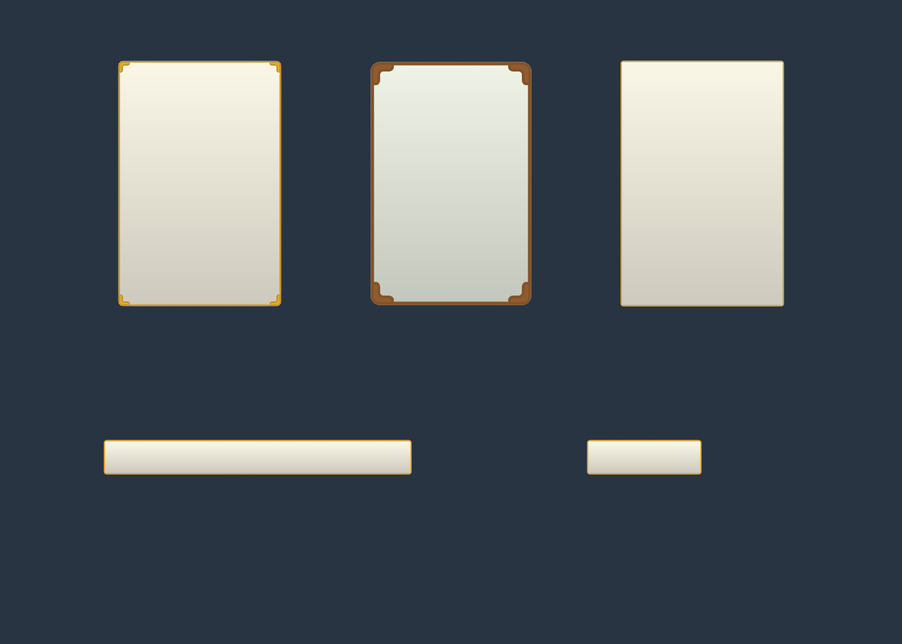

# 공통 타일 UI 키트

타워 스폰 타일의 밝은 바탕과 모서리 장식을 유지하면서, 비율별 이미지를 고르지 않고 크기와 선 두께를 조절하는 구조로 바꿨습니다.

## 바로 사용

`Assets/2. Prefab/UICommon/`의 프리팹을 Canvas 안으로 끌어다 놓습니다.

| 프리팹 | 기본 용도 |
|---|---|
| `UITilePanel.prefab` | 일반 패널, 320×180, 프레임 자동 선택 |
| `UITileButton.prefab` | 버튼, 180×56, 간결한 프레임. Button과 targetGraphic 연결 포함 |
| `UITileCard.prefab` | 세로 카드, 256×384, 장식 프레임 |

1. 루트 RectTransform의 가로·세로를 원하는 크기로 바꿉니다. 비율 제한은 없습니다.
2. 루트 `UITilePanel`에서 **프레임 모양**, **테두리 두께**, **배경·프레임 표시**를 설정합니다.
3. **스테이지 색상 사용**을 켜면 상위 `UIStageThemeController`의 A/B/C/Frame 색을 사용합니다. 끄면 배경색·프레임색을 직접 지정할 수 있습니다.
4. 텍스트나 아이콘 등 실제 내용은 `Content` 아래에 넣습니다. 내용에 맞춰 Content 여백도 조절할 수 있습니다.

`Auto`는 짧은 변이 96 UI 단위 미만이면 간결한 프레임, 그 이상이면 장식 프레임입니다. `Decorated`/`Compact`로 고정할 수도 있습니다. 두께는 화면의 물리 픽셀이 아니라 UI 단위이며, 작은 영역에서는 모서리가 겹치지 않도록 자동으로 줄어듭니다. Canvas의 기준 PPU가 달라져도 지정한 두께를 유지합니다.

새 빈 패널은 `GameObject > UI > 타일 공통 패널`로도 생성할 수 있습니다. 기존 UI는 선택 후 `Tools > UI > 공통 스킨 연결`을 사용합니다. 이름의 A/B/C/Frame 역할이나 기존 UITileSurface 설정만 확인하며, `3:2` 같은 비율 표기는 필요 없습니다. 기본적으로 기존 색상을 보존하고 Ctrl+Z로 되돌릴 수 있습니다. Filled 게이지는 연결 도구에서 제외합니다.

## 실제 변경

- 아틀라스: **4096×2048 → 1024×256**. 텍스처 픽셀 수는 **1/32**입니다.
- 실제 그림은 **밝은 배경 / 장식 프레임 / 간결한 프레임**, 세 종류만 저장합니다.
- 기존 스프라이트 이름 60개와 GUID/fileID를 호환용 별칭으로 유지합니다. Sprite Editor에서 보이는 항목은 신규 원본 3개를 합쳐 63개지만, 실제 이미지 영역은 세 곳뿐입니다. 기존 이름의 크기·비율 접미사는 호환용 이름입니다.
- 명암은 알파가 있는 모든 픽셀에서 **RGB 200~255의 회색조**입니다. 압축으로 명암이나 알파가 깨지지 않도록 공통 아틀라스의 텍스처 압축을 해제했습니다. 픽셀 수 감소율과 실제 GPU 메모리 감소율은 압축 방식 때문에 같지 않습니다.
- 기본 스킨은 `Assets/Resources/UITileSkin.asset`에 세 원본과 원본 선 두께를 연결했습니다.
- Canvas.prefab의 공통 UI 이미지 **44개**, BuffPrefab.prefab의 **2개**를 UITileSurface 방식으로 연결했습니다. 기존 이름·RectTransform·Image 색·레이캐스트·버튼 이벤트·수동 색상 목록은 보존했습니다.
- UIStageThemeController는 세 원본을 공유해도 각 이미지의 A/B/C/Frame 역할과 수동 색을 유지합니다.
- 보석·스탯·버튼 아이콘 아틀라스와 이전 카드 시안은 수정하지 않았습니다.

UITileSurface는 크기/Canvas 설정에 맞춰 Image의 Sliced 배율을 계산하며, 값이 바뀔 때만 Image 속성을 갱신합니다. 실행 중 매번 텍스처를 만들거나 비율별 스프라이트를 생성하지 않습니다.

## 확인

별도 Unity **6000.3.9f1** 프로젝트에서 실제 uGUI를 사용한 **176개 검사 통과**:

- 공통 원본 3개, 기존 스프라이트 fileID 60개, 동일한 텍스처 공유
- 가로형·세로형·정사각형·24×24 작은 버튼 등 크기 8종에서 실제 UI 메시 생성
- 크기 변경에 따른 프레임 자동 전환, 배경·프레임 모서리 배율 일치
- Canvas 기준 PPU 변경 시 두께 유지
- 스테이지 10종의 A/B/C/Frame 색상, 직접 지정 색과 수동 Image 색 유지
- Filled 게이지의 종류와 fillAmount 유지
- 비율 이름 없는 UI 연결 및 기존 색상 보존
- 프리팹 3종 저장·재생성, 버튼 targetGraphic 연결
- 실제 GPU 렌더 이미지 생성

게임의 런타임·Editor C# 전체를 별도로 컴파일하여 **경고 0개 / 오류 0개**를 확인했습니다. 열려 있는 본 게임의 Play Mode는 실행하지 않았습니다. 새로 생성한 프리팹은 검증 프로젝트에서 가져왔고, 배포한 파일이 검증한 파일과 같은지는 `export-verification.json`에서 확인합니다.

위쪽 왼쪽부터 장식형 두께 2, 장식형 두께 4, 간결형 두께 2입니다. 아래는 긴 버튼과 일반 버튼입니다. 빈 패널만 보여주는 실제 Unity 렌더이며 텍스트·초상은 별도로 추가하면 됩니다.

## 제작 자료

- [asset-report.json](asset-report.json): 아틀라스 및 기존 UI 이전 결과
- [unity-verification.json](unity-verification.json): Unity 검사 결과
- [export-verification.json](export-verification.json): 검증 파일과 배포 파일 일치 확인
- [compact-frame-prompt.txt](compact-frame-prompt.txt): 내장 imagegen으로 제작한 작은 프레임 프롬프트
- [compact-frame-generated.png](compact-frame-generated.png): 생성 원본
- `before/`: 이번 작업 직전 아틀라스와 Canvas/BuffPrefab 원본
- `Build-Assets.cjs`: 원본 세 개 패킹, 호환 별칭 생성, 기존 UI 연결. 이후 다른 수정이 생긴 파일은 덮어쓰지 않습니다.
- `Prepare-Unity.cjs`, `UICommonKitCheck.cs`: 격리된 Unity 검증 준비와 검사
- `Compile-Project.ps1`: 본 게임 C# 컴파일 검사

장식형은 이전 작업에서 내장 imagegen으로 만든 프레임을 재사용했고, 간결형은 같은 도구로 새로 제작했습니다. 생성 원본은 투명 가장자리 정리·회색조 범위 통일·아틀라스 패킹을 거쳤습니다.
