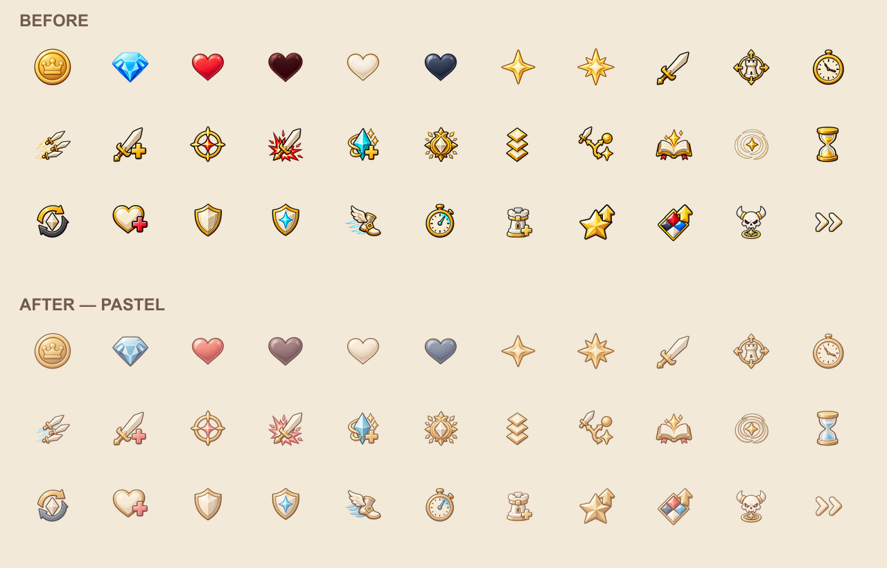

# 파스텔 UI 아이콘

현재의 밝은 타일 UI에 맞춰 재화·스탯·버튼 아이콘을 샴페인 골드, 코랄, 더스티 블루, 아이보리와 코코아 윤곽선으로 맞췄습니다. 내장 imagegen으로 기존 아이콘을 참고해 스타일을 수정했습니다.

## 적용 파일

| 파일 | 내용 |
|---|---|
| `Assets/4. Asset/5. UI/UI_Icon_Atlas.png` | 재화·하트·장식 별 8개 |
| `Assets/4. Asset/5. UI/Stat_Icon_Atlas_v2.png` | 타워·적 스탯 20개 |
| `Assets/4. Asset/5. UI/Button_Symbol_Atlas.png` | 생성·강화·중간보스 버튼 4개 |
| `Assets/4. Asset/5. UI/Btn_Symbol_GameSpeed.png` | 배속 1개 |

총 **33개 아이콘**, PNG **4개**를 교체했습니다. 각 문양의 의미와 배치는 유지하고, 강한 원색·금속 광택·검은 윤곽선을 부드럽게 다듬었습니다. 채워진 하트와 비어 있는 상태, 4각/8각 별, 스탯별 모양, 컬러 강화의 빨강·파랑·아이보리·짙은 회색 구분은 남겨 두었습니다.

기존 `.meta`는 바이트 단위로 그대로입니다. 아틀라스 크기, GUID, Sprite fileID, rect, pivot과 가져오기 설정을 변경하지 않았습니다. 배속은 Single Sprite로 쓰이므로 실제 참조는 `21300000`이며, 메타데이터 안의 사용하지 않는 슬라이스 항목과 구분해 확인합니다.

새 그림은 원래 아이콘의 표시 영역에 비율을 유지해 맞췄습니다. 생성 결과의 투명 배경에 섞인 고채도 잔여 픽셀과 작은 독립 잡티를 정리하고, 완전한 도형을 각 셀에 대응시켜 잘림 없이 패킹했습니다. 프리팹, UI 위치, 이미지 색상 설정, 버튼 이벤트, 게임 스크립트와 공통 배경 아틀라스는 이번 작업에서 수정하지 않았습니다.

## 확인 자료

- [comparison.png](comparison.png): 아이보리 바탕에서 작은 크기로 본 전체 전후 비교
- [unity-preview.png](unity-preview.png): 별도 Unity 프로젝트에서 실제 uGUI로 렌더한 전후 비교. 위쪽은 기존, 아래쪽은 변경 후이며 맨 아래는 32 크기의 표시 예시입니다.
- [verification.json](verification.json): 33개 아이콘의 크기·원래 표시 영역·새 표시 영역·메타데이터/이미지 해시
- [unity-verification.json](unity-verification.json): 실제 Unity 가져오기와 참조·rect·pivot 검사 결과
- [export-verification.json](export-verification.json): 게임에 적용한 이미지와 검사한 이미지 일치, 비대상 파일 보존 확인

Unity 6000.3.9f1의 격리 프로젝트에서 **109개 검사**를 통과했습니다. 33개 아이콘의 실제 GUID/fileID·rect·pivot과 64·32 크기의 표시를 확인했습니다. 본 게임의 Play Mode는 실행하지 않았습니다. 게임 코드 변경이 없어 이번 작업에서는 전체 C# 빌드를 반복하지 않았습니다.

## 원본과 재생성

`before/`는 작업 직전 PNG와 메타데이터, `staged/`는 적용 이미지 사본, `cells/`는 각 아이콘 확인용 이미지입니다. `unchanged-files.json`에는 비대상 UI 파일과 Canvas/BuffPrefab/테마 스크립트의 작업 전 해시가 있습니다.

생성 프롬프트와 원본:

- [재화 프롬프트](currency-prompt.txt) · [생성 원본](currency-generated.png)
- [스탯 프롬프트](stats-prompt.txt) · [생성 원본](stats-generated.png)
- [버튼 프롬프트](buttons-prompt.txt) · [생성 원본](buttons-generated.png)
- [배속 프롬프트](speed-prompt.txt) · [생성 원본](speed-generated.png)

`node outputs/ui-icons-pastel-v1/Build.cjs`로 확인용 파일을 만들고, `--apply`를 붙이면 기존 PNG에 적용합니다. 대상 PNG나 메타데이터에 이번 작업과 다른 수정이 생기면 덮어쓰지 않습니다. `UIIconAudit.cs`는 앞서 만든 `outputs/ui-common-kit-v1/unity-validation`에서 실행하는 검사입니다.
