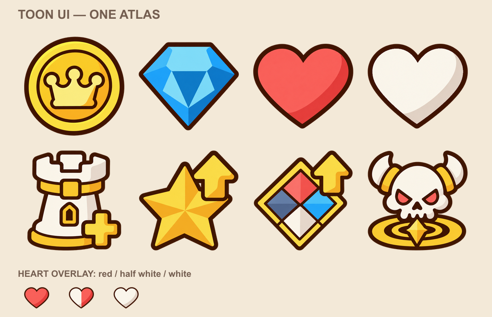

# 만화툰 UI 아이콘 통합

재화·하트 4개와 버튼 심볼 4개를 하나의 `UI_Icon_Atlas.png`에 합쳤습니다. 굵은 코코아 윤곽선과 간단한 명암의 만화툰 스타일입니다. 사용자의 추가 요청에 따라 금색·빨강·파랑의 채도를 올리고, 확대 표시를 위해 아이콘 원본을 더 크게 다시 제작했습니다. 내장 imagegen을 사용했습니다.

## 최종 구성

| 위쪽 줄 | 아래쪽 줄 |
|---|---|
| 골드 `Icon_Gold` | 타워 생성 `Symbol_CreateTower` |
| 다이아 `Icon_Gem` | 티어 강화 `Symbol_TierUpgrade` |
| 빨간 하트 `Icon_Heart` | 컬러 강화 `Symbol_ColorUpgrade` |
| 흰 하트 `Icon_Heart_White` | 중간보스 `Symbol_MiddleBoss` |

흰 하트는 사용자 요청대로 **빨간 하트에 덧씌우는 기존 방식의 흰 하트**입니다. 두 하트는 외곽선·크기·중심점과 알파 마스크를 공유합니다. 파란 방패 모양은 최종 에셋에 없습니다. 부분 채우기나 알파로 덧씌울 때도 가장자리가 맞습니다.

제거한 것은 `Icon_Heart_Frame`, `Icon_Heart_Black`, 장식용 `Icon_Deco_Star4`, `Icon_Deco_Star8`입니다. 티어 강화 버튼의 기능을 뜻하는 별 모양은 유지했습니다.

## 게임에 반영

- `Assets/4. Asset/5. UI/UI_Icon_Atlas.png`: **2048×1024**, 512×512 셀 8개.
- 축소할 때 윤곽선이 거칠어지지 않도록 Bilinear 필터를 사용하고, 알파와 색을 유지하도록 압축을 해제했습니다.
- 기존 재화·빨간 하트·흰 하트의 GUID/fileID를 유지했습니다. 흰 하트의 셀 위치만 위쪽 네 번째로 옮겼습니다.
- 버튼 심볼의 fileID와 이름은 유지하고, 사용하는 텍스처 GUID를 통합 아틀라스로 옮겼습니다.
- Canvas.prefab에서 버튼 심볼을 쓰던 이미지 3개를 새 GUID로 연결했습니다.
- 없애는 빈 하트를 쓰던 `Img_Life_Contain...`의 Image 1개는 비활성화하고 Sprite 연결을 비웠습니다. GameObject와 자식, RectTransform, 버튼 이벤트 등은 유지했습니다.
- 별도 `Button_Symbol_Atlas.png`와 `.meta`는 사용처 이전과 검증 후 삭제했습니다. 기존 파일은 `before/`에 보관했습니다.
- 스탯·배속 아이콘, 공통 UI 배경, 게임 스크립트는 이번 통합에서 바꾸지 않았습니다.

두 텍스처의 픽셀 수 합계는 4,718,592에서 2,097,152로 약 **44%**가 됩니다. 확대 품질을 위해 첫 통합안의 256px 셀을 512px로 높였습니다. 같은 텍스처를 공유하게 되지만 실제 드로콜 수는 Canvas·머티리얼·그리기 순서에 따라 달라집니다.

## 확대 시 거칠어 보이던 이유와 수정

기존 UI 아이콘의 필터는 Point였고 첫 통합안은 아이콘당 256px였습니다. Point는 픽셀 경계를 그대로 보여 주며, 래스터 아이콘을 크게 늘리면 계단이 눈에 띕니다. PNG 전체 크기뿐 아니라 각 셀의 해상도도 중요합니다.

최종안은 재화 4종과 버튼 4종을 각각 **1254×1254** 원본으로 다시 생성했습니다. 각 셀의 원본 해상도는 627px이며, 이를 512px 셀로 줄여 넣었습니다. 기존 256px 셀을 확대해서 만든 것이 아닙니다. Bilinear 필터, 압축 없음, 최대 텍스처 크기 2048로 설정했고 Unity가 실제로 2048×1024로 가져왔는지 검사합니다. 비트맵이므로 원본 해상도를 넘는 무한 확대까지 선명한 방식은 아닙니다.

## 확인

- [verification.json](verification.json): Sprite ID, 제거 항목, Canvas 연결 변경, 하트 마스크 비교
- [unity-verification.json](unity-verification.json): 실제 Unity 가져오기·참조·하트 겹침 검사
- [unity-preview.png](unity-preview.png): 실제 uGUI 렌더. 아래쪽은 빨강 위로 흰 하트를 0/25/50/75/100% 채우는 예시
- [unity-zoom-preview.png](unity-zoom-preview.png): 2400×1600 확대 렌더
- [final-verification.json](final-verification.json): 적용 파일 및 기존 아틀라스 참조 제거 확인

별도 Unity 6000.3.9f1 프로젝트에서 **27개 검사**를 통과했고, Unity에서 읽은 빨강·흰 하트의 알파 차이는 **0픽셀**입니다. 본 게임 Play Mode를 실행하거나 하트 표시 기능 자체를 새로 구현한 작업은 아닙니다. 기존 씬 기록용 `.bak_naming` 파일과 과거 작업 출력은 원본 기록으로 남겼습니다.

## 제작 자료

- [prompt.txt](prompt.txt): 최초 통합 프롬프트
- [refinement-prompt.txt](refinement-prompt.txt): 만화툰 명암 단순화
- [white-heart-prompt.txt](white-heart-prompt.txt): 흰 하트 수정 요청
- [generated.png](generated.png): 첫 통합 이미지 생성 원본
- [resources-hires-prompt.txt](resources-hires-prompt.txt) · [재화 고해상도 원본](resources-hires-generated.png)
- [buttons-hires-prompt.txt](buttons-hires-prompt.txt) · [버튼 고해상도 원본](buttons-hires-generated.png)
- `before/`: 변경 전 아틀라스·메타데이터·Canvas 원본
- `Merge.cjs`: 투명 가장자리 정리, 셀 패킹, 하트 공통 마스크, 메타데이터 및 사용처 이전
- `MergedIconCheck.cs`: 격리 프로젝트의 실제 Unity 검사

이미지 생성 이후 패킹 단계에서 두 하트가 동일한 외곽선과 알파를 쓰도록 맞췄습니다. `node outputs/ui-icons-toon-merged-v1/Merge.cjs`는 확인용 파일을 만들고, `--apply`를 붙이면 적용합니다. 이후 다른 수정이 생긴 파일은 덮어쓰지 않습니다.
