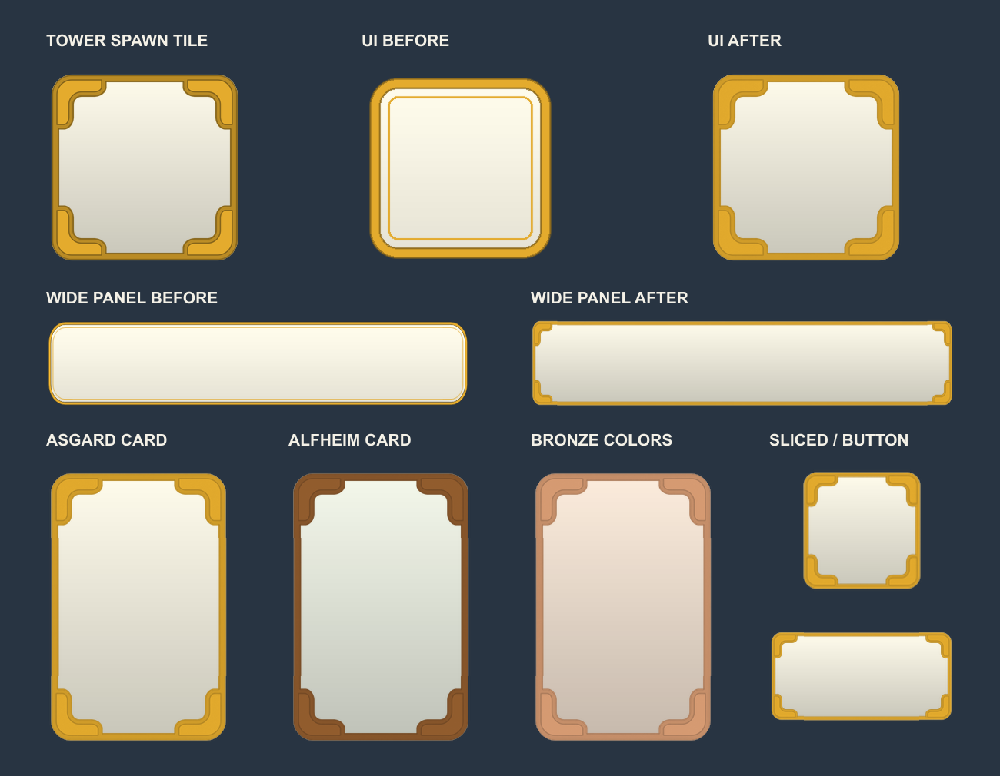

# 타워 스폰 타일과 맞춘 공통 UI

2026-10-17. 사용자가 원하는 방향은 UI의 바탕과 테두리를 타워 스폰 타일과 비슷하게 맞추는 것으로 확인했습니다. 공통 UI의 기존 가는 이중선 테두리를 타일 모서리 장식이 있는 밝은 프레임으로 교체했습니다.

## 적용

- 변경한 게임 파일: `Assets/4. Asset/5. UI/Shared_UI_Atlas.png` 하나.
- 기존 4096×2048 아틀라스, 60개 스프라이트의 이름·위치·크기·GUID·fileID·pivot·border·가져오기 설정 유지.
- A/B/C는 같은 밝은 회색 바탕을 공유합니다. 각 UI의 기존 Image 색상으로 역할과 스테이지 색을 구분합니다.
- 배경은 현재 `Board_Background.png`의 부드러운 세로 그라데이션을 사용합니다.
- 프레임은 내장 imagegen으로 만든 밝은 버전의 표면 명암을 사용하되, 생성 결과의 가장자리 잡티가 들어가지 않도록 실제 `Board_Decoration.png`의 투명 마스크에 맞춰 결합했습니다.
- 512px 원본에서 모서리를 보존해 비율별로 패킹했습니다. 직사각형도 모서리와 선 두께가 짧은 변을 기준으로 맞습니다. 128_B 조각의 기존 Sliced border 48은 그대로입니다.
- 불투명·반투명 픽셀은 모두 `R=G=B`, 명암 200~255입니다. 투명 픽셀은 RGBA 0입니다.
- 현재 컬러 보석·스탯·버튼 아이콘은 유지했습니다. 파일 삭제나 UI 위치 변경은 없습니다.

## 확인

`Build.cjs`에서 60개 조각의 명암 범위, 겹침, 배경 중앙 불투명, 프레임 중앙 투명, 아틀라스 여백 보존을 확인했습니다. 적용 PNG와 검증한 후보 PNG의 SHA-256이 동일합니다. UI 폴더의 다른 파일 및 Canvas/BuffPrefab/UIStageThemeController가 작업 전 해시와 일치합니다.

`comparison.png`는 실제 PNG를 색상과 곱해 만든 전후 비교이며 Unity 게임 화면 캡처는 아닙니다. Unity Play Mode의 입력·배치 검증은 이번 작업에서 실행하지 않았습니다. 기존 카드 시안 v3는 그대로입니다.

## 파일

- [comparison.png](comparison.png): 원래 스폰 타일 / 기존 UI / 변경 UI 및 비율·색상별 예시
- [Shared_UI_Atlas.tile-style.png](Shared_UI_Atlas.tile-style.png): 게임에 적용한 아틀라스 사본
- [verification.json](verification.json): 조각별 검증 결과
- [frame-prompt.txt](frame-prompt.txt): 내장 imagegen 생성 프롬프트
- [generated-frame.png](generated-frame.png): 생성 원본
- [frame-source.png](frame-source.png): 실제 타일 투명 마스크와 결합한 프레임 원본
- `before/Shared_UI_Atlas.png`: 변경 전 원본
- `before/Shared_UI_Atlas.png.meta`: 변경 전 메타데이터
- `before-hashes.json`: 작업 전 파일 해시

재생성: `node outputs/ui-tower-tile-style-v1/Build.cjs`

적용: `node outputs/ui-tower-tile-style-v1/Build.cjs --apply`
